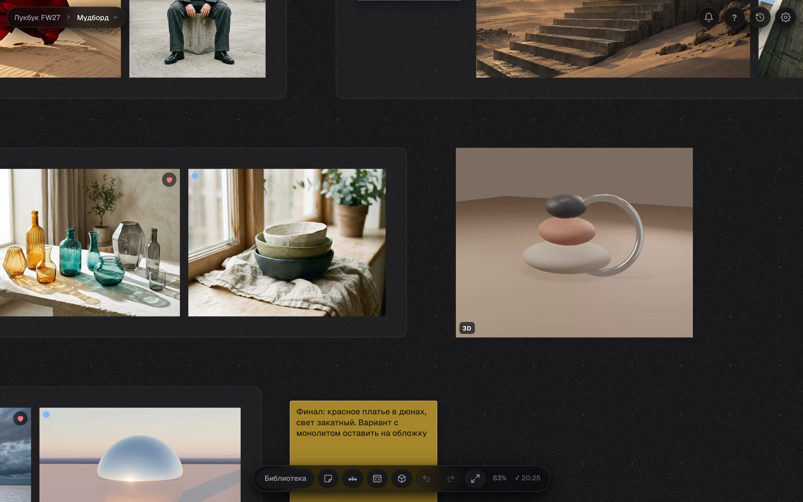
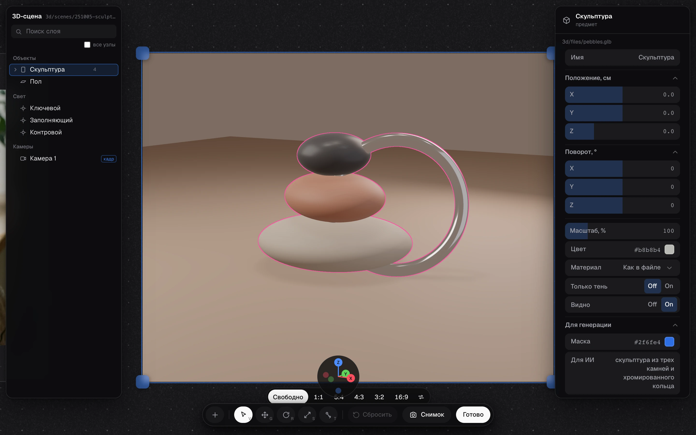

# Hyimg 3D

[English](README.md)




3D-карточка на доске и 3D Studio: дерево сцены, свет, камера, свойства предмета

Плагин Hyimg: 3D-сцена лежит на холсте карточкой, редактируется в браузере и хранится в json, который агент переносит в Blender и обратно. Что умеет плагин и почему так решено: [FEATURES.md](FEATURES.md).

## Установка

Плагин работает внутри Hyimg (https://github.com/constantvis/Hyimg). Проще всего поставить его скриптом Hyimg, он кладет эту папку рядом с `hyimg` и ставит ссылку:

```sh
cd hyimg && ./scripts/install_plugins.sh --3d
```

Вручную: склонировать репозиторий и сделать ссылку `ln -s <путь к hyimg-3d-studio> ~/Library/Application\ Support/Hyimg/plugins/3d`, потом перезапустить сервер Hyimg (⇧⌘R). Сборщик не нужен, three.js лежит в `vendor/`. Для переноса сцен в Blender и обратно нужен Blender (проверено на 5.2), карточки на доске работают и без него.

**Агенту:** не ставь плагин молча. Спроси человека, нужен ли ему плагин «3D-объекты» (3D-сцены карточками на доске, перенос в Blender), и ставь только после «да».

## Файлы

- `canvas.js`: легкая часть: карточка и ее снимок из `.posters` без three.js, слежение за сценами и `inbox.json`.
- `engine.js`: грузится только по необходимости: 3D Studio в духе Spline (дерево слоев с поиском, свойства на DialKit, панель иконок, круг осей, розовая подсветка), снимок, защита от тяжелых сцен.
- `scene.js`: формат сцены и его перевод в three.js и обратно, загрузка моделей, проходы для снимка (вид, маски, глубина).
- `models.py`: маршруты сервера Hyimg: список моделей доски для меню «+» и недавние 3D-файлы проекта.
- `empty.js`: пустая карточка с кнопками «Открыть файл…», «Медиатека» и недавними. `loaders.js`: чтение glb, gltf, obj, stl, fbx и перевод в glb. `cad.py` и `cad_freecad.py`: STEP и IGES превращаются в glb через FreeCAD (нужен только для них, сам плагин его не ставит). `sprites.js` и `turn.js`: лист кадров для поворота по наведению.
- `blender/hyimg_scene.py`: перенос сцены в Blender и обратно, запускается агентом.
- `tests/`: `test_canvas_3d.py` (холст в Chromium), `blender_test.py` и `convert_test.mjs` (Blender и сверка формул с его glTF-экспортом).
- `vendor/`: three.js r180 (MIT, `vendor/three/LICENSE`), импорты переписаны на относительные пути, сборщик не нужен. Декодер Draco (Apache-2.0, `vendor/draco/LICENSE`). DialKit 2.0.2 (MIT, `vendor/dialkit/LICENSE`): сборка `dist/vanilla` без зависимостей и ее стили.

## Где что лежит в библиотеке проекта

- Сцены: `3d/scenes/<ГГММДД-ЧЧММСС>/scene.json`, рядом `scene.glb` (геометрия из Blender), `.blend`, если агент его сохранил там, и `.posters/` со снимками карточек.
- Модели: `3d/models/<id>/model.json` и его `.glb`: `title` (имя в меню «+» и в сцене), `ai` (строка для ИИ), `height_m` (высота в сцене, в метрах), `height` (высота в единицах файлов), `parts` (`role`, `file`, `keep`, `mirror`, `rotate_y`). Модель с частью `phone` собирается как телефон в чехле: части чехла встают вокруг телефона. Новая сцена начинается с шара-заглушки, модель добавляется из «+». `assembled.glb` рядом пишет холст: та же сборка одним файлом в метрах, для Blender.
- Файлы, которые человек выбрал в окне «Открыть файл…»: `3d/files/<хеш>/<имя>.glb`, переведенные из других форматов: `3d/converted/`. Недавние файлы: `3d-recent.json` в папке состояния проекта.
- Снимки: `3d/shots/<ГГММДД>/`: вид, маски и глубина, у каждого json со сценой, камерой и легендой масок.
- Просьба положить камеры на холст: `3d/scenes/inbox.json` `{id, scene, cameras: [...]}`. Открытый холст забирает ее в течение 2 с.

## Карточка на доске

`{"type": "model3d", "scene": "3d/scenes/.../scene.json", "camera": "<id камеры>", "bg": {"transparent", "color", "opacity"}, "x", "y", "w", "h"}`. `bg` это фон карточки, а не сцены: у двух карточек одной сцены он может быть разный. Пропорции карточки равны размеру кадра сцены (`render`). Старые карточки `{model, cam, colors}` показываются через ту же сцену и при первом открытии получают файл.

## Формат scene.json

Описан в начале `scene.js`. Коротко: метры, z вверх, повороты кватернионами `[w, x, y, z]` мировой матрицы, свет в ваттах (солнце в Вт/м²) с цветом в линейном RGB, камера с объективом в мм, сенсором и `fit`, как в Blender. Предмет: `src` = `prim` (куб, цилиндр, шар, плоскость с размерами), `model` (модель библиотеки), `file` (glb библиотеки) или `node` (узел `scene.glb`, найденный по `hyimg_id` в glTF extras). Поле `ai` у предмета идет в промпт снимка, `mask` задает цвет маски, `finish` материал, `shadow_only` оставляет только тень (в Blender shadow catcher), `layers` хранит настройки отдельных деталей по пути имен из дерева (`phone.glb/Sketchfab_model/…`, зеркальная половина с `~зеркало`). `removed` перечисляет удаленные id, чтобы другая сторона их не вернула.

Холст пишет файл только при настоящем изменении и на месте (`POST /api/file`): папка не меняет время, библиотека не пересканируется.

## Агенту: сцена с холста в Blender и обратно

Скрипт работает внутри Blender (5.2 в `/Applications/Blender.app`), фоном или в открытом окне. Путь к сцене абсолютный, библиотека находится по папке `3d`.

```bash
# собрать новый .blend по сцене
/Applications/Blender.app/Contents/MacOS/Blender -b --factory-startup --python blender/hyimg_scene.py -- apply "<библиотека>/3d/scenes/<имя>/scene.json" --fresh --save-as "<библиотека>/3d/scenes/<имя>/scene.blend"
# обновить существующий .blend (предметы находятся по hyimg_id, остальное в файле не трогается)
/Applications/Blender.app/Contents/MacOS/Blender "<файл.blend>" -b --python blender/hyimg_scene.py -- apply "<scene.json>" --save
# выгрузить .blend в сцену; --cards кладет на холст карточку на каждую камеру
/Applications/Blender.app/Contents/MacOS/Blender "<файл.blend>" -b --python blender/hyimg_scene.py -- export "<scene.json>" --cards
```

После выгрузки с `--cards` скажи владельцу, что на холсте появились камеры: `python3 <Hyimg>/review/hy.py notify "Из Blender: 3 камеры сцены «…» на холсте"` (колокольчик на холсте, правило в скилле hyimg-board).

В Blender у предметов сцены есть свойства `hyimg_id`, `hyimg_src`, `hyimg_ai`, `hyimg_mask`: по ним сцена узнает свои предметы при следующем переносе. Свой предмет Blender (без `hyimg_src`) уходит на холст геометрией в `scene.glb`. Простые фигуры с холста возвращаются фигурами.

## Карточка в Blender

Сцена из рендеров Blender-студии (`tools/studio_angles.py`: камера на каждую картинку, геометрия студии одна) получает в 3D Studio переключатель «three.js · EEVEE · Cycles». На EEVEE и Cycles карточка показывает кадр Blender своей камеры, он рендерится шагами, как только камера остановилась. OK рендерит финальный кадр картинки (ее размер, сэмплы и экспозицию) и кладет его рядом с карточкой, json рядом позволяет повторить кадр. Blender один на проект и живет за сервером Hyimg (`bridge.py`, `blender/bridge_server.py`). Текущие материалы он собирает собственным скриптом студии до его рендера и ничего в студии не меняет (`blender/studio_looks.py`). Какие материалы текущие, говорит `looks/current.json` студии, а пока его нет, самая новая серия ее рендеров. Подробности в FEATURES.md.

## Подключение

Hyimg ищет плагины в `HYIMG_PLUGINS` (пути через `:`) и в `~/Library/Application Support/Hyimg/plugins`. Достаточно ссылки на эту папку: `ln -s <путь к Hyimg-3d> ~/Library/Application\ Support/Hyimg/plugins/3d`. Серверная часть плагина (`models.py`, список моделей доски) подключается по `manifest.json` сама.

## Тесты

```bash
python3 -m pytest tests/test_canvas_3d.py                 # HYIMG_REPO=<Hyimg>; маленькую модель тест собирает сам
python3 -m pytest tests/test_3d_files.py                  # файл в карточку, фильтр 3D в медиатеке, поворот: Chromium и WebKit
/Applications/Blender.app/Contents/MacOS/Blender -b --factory-startup --python tests/blender_test.py -- <пустая папка>
node tests/convert_test.mjs <та же папка>
```

**Агенту, который меняет код:** исходный файл держать около 1000 строк (проверка падает выше 1100), строку около 160 символов (выше 200 падает). Файл у лимита делить по ответственности, одна задача на модуль. Правило и исключения в `AGENTS.md` репозитория Hyimg, раздел «Размер файлов». `scripts/check.sh --fast` в `hyimg` проверяет и этот репозиторий.

## Лицензия

[PolyForm Noncommercial 1.0.0](LICENSE): пользоваться, изучать и менять бесплатно для себя и для некоммерческих целей. Коммерческое использование только с разрешения автора, напишите через GitHub. Сторонний код в `vendor/` остается под своими лицензиями.
